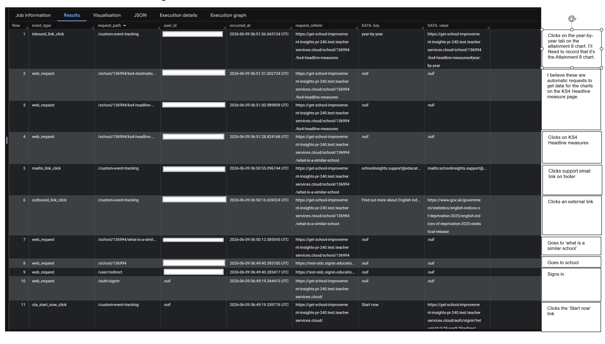

# `sap-sector` DfE Analytics Integration

**Author:** Chris Morriss
**Last Updated:** October 2026
**Status:** Living document

---

## Overview

https://github.com/DFE-Digital/dfe-analytics-dotnet is an internally developed shared library for capturing service usage data and storing it in Google's BigQuery platform for analysis. 

The original library was originally developed for Ruby based services but extended for use with .NET. It is used by both `sap-sector` and `sap-public` services to send web request and custom events data to the Google BigQuery platform. 

A web request is defined as a request to a controller action. A custom event is defined as an event that is triggered by a user action on the front end of the service, though
capturing the event does involve passing event data to a controller action via a JavaScript fetch request.

An exmample of a web request event is a user visiting the school details page for a school with URN 123456 e.g. /schools/primary/123456. An example of a custom event is a user clicking 
on a external link or an email address link.

Currently, only clicks on achor tags are captured as custom events. These include:

- External links i.e. all achor tags where the href is not the service URL host name
- All anchor tags where the href begins with 'mailto:'
- The feedback link in the phase banner and footer
- Clicks on the 'Start now' link on the service start page. While 'Start now' is styled as button it is an achor tag.

The below image shows how web request and custom event data is presented in BigQuery. The example show the activity for a user starting their journey on the 'Start now' link in the first row at the bottom of the image.

The sequence of events is as follows:

1. The user clicks on the 'Start now' link on the service start page. This is a custom event that's captured by a JavaScript event listener and sent to the `CustomEventController` via a fetch request. The controller then processes the data captured with the DfE Analytics library sending the data to BigQuery.
2. There are then two DSI login related web request events. The first one is the user being redirected to the DSI login page. The second one is the user being redirected back to the service after successful login. Note that the `user_id` value is `null` for the `cta-start-now` custom event and the `web_request` event. This is because the `user_id` GUID is provided by DSI and only exists once the user has successfully logged in. Subsequent request do include the `user_id` but they are redacted in the image above for privacy reasons. 
3. The next two `web_request` events are the user accessing a school page and the 'what is a similar school' page.
4. The next steps involve various other custom events and web requests.

## Code Design

` builder.Services.AddDfeAnalyticsDependencies(builder.Environment);`

This adds two DfE Analytics services, the main DfE Analytics ASP.NET Core service and the service that captures and processes custom events. 

As the connection to Google BigQuery is not available for local development, a non-operational version of the DfE Analytics custom event service is added when the environment is local development.

The DfE Analytics middleware is included here. This middleware captures web request events and sends them to Google BigQuery.

## Front end JavaScript to capture custome events.

To capture clicks on achor tags, a JavaScript event listener is added to the service layout page. This event listener captures clicks on achor tags and sends the event data to the `CustomEventController` via a fetch request.

In the `CustomEventController`, the event data is checked to determine the type of custom event, feedback, external link, email link or 'Start now' link, then added to the HTTP request and sent to BigQuery.

# `sap-sector` Google Tag Manager and Google Analytics Integration

